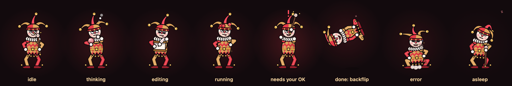

<div align="center">


# Jester

**A tiny court jester that lives on your screen and keeps an eye on Claude Code for you.**

He thinks while Claude thinks, types while it edits, waves when it needs your OK, and backflips when the job is done,
so you can go get coffee and still know the moment to come back.

[](https://github.com/tupesanket1999/jester/releases)
[](https://github.com/tupesanket1999/jester/actions/workflows/ci.yml)
[](LICENSE)


[**Install on Mac**](#mac) · [**Download for Android**](https://github.com/tupesanket1999/jester/releases) · [Features](#features) · [FAQ](#faq)

</div>



## Why

Claude Code runs for minutes at a time. You switch to Slack, a browser, another repo, and then either check back
too often or miss that it's been waiting on a permission prompt for ten minutes. Jester floats above everything and
tells you, with a pose and a little sound, exactly when you're needed. Click him and you're back in the right window.

## Features

### Mac: your Claude Code sidekick
- **Live session states.** Thinking, editing, running a command, reading, error. Every pose is driven by real
  Claude Code hook events, across every terminal, IDE and the desktop app at once.
- **Taps you on the shoulder only when it matters:**
  - **done**: a prompt finished while you were in another app
  - **needs your OK**: a session has been blocked on a permission prompt for 20 s
  - **idle**: a finished session has sat unattended for 3 minutes
  - **resume**: you come back to a project after a break and get a one-line "what you were doing, what's next"
  - **break**: after 50 minutes of continuous work
- **One click to jump back** to the exact session window (exact workspace with [AeroSpace](https://github.com/nikitabobko/AeroSpace)).
- **Sound and voice.** Synthesised sound effects (no audio files), babble, and optional spoken lines when you're away.
- **Stays out of the way.** Drag him anywhere; `⌃⌥J` hides him; `⌃Space` dismisses a bubble. No Accessibility
  permission, no account, no server.

### Android: a jester that floats over every app
- **Floating overlay.** Drag him anywhere, he snaps to the edge, and his hat tails swing with your finger.
- **Reminders that are hard to ignore.** He hops with the reminder in a speech bubble until you press Done or Snooze,
  and notifications mirror to your smartwatch.
- **Share to Jester.** Share text or a screenshot; on-device text recognition turns it into an item.
- **Outfits and moods.** Themes, an automatic outfit by time of day, quiet hours, sound and voice settings.
- **Works offline.** Exact alarms for cached reminders, and an offline write queue when a hub is connected.

### Both
- **A real animated character, not a GIF.** IK limbs, spring physics on the hat tails, juggling, backflips,
  pratfalls, idle tricks and particles, rendered live at 30–60 fps.
- **Bring your own mascot.** Prefer a retro pixel robot? It's bundled. Or draw your own with the
  [bot pack format](docs/HUB_API.md#bot-packs-same-mascot-on-every-device): a palette and a few ASCII layers.
- **Optional sync.** Point both apps at your own [hub](docs/HUB_API.md) to share reminders, chat and mascots across
  devices. Nothing is sent anywhere by default.

## Install

### Mac
Needs macOS 13+ and [Claude Code](https://claude.com/claude-code).

```bash
brew install tupesanket1999/tap/jester
brew services start jester
jester hooks install     # adds the Claude Code hooks (appends to your settings, with a backup)
jester demo              # watch him walk through every state
```

Homebrew builds it from source in about a minute. Without Homebrew:
`git clone https://github.com/tupesanket1999/jester && cd jester/mac && ./install.sh` ([details](mac/README.md)).

### Android
1. Download the newest `jester-android-*.apk` from [Releases](https://github.com/tupesanket1999/jester/releases).
2. Open it and allow installs from your browser or files app.
3. Follow the setup checklist and grant **Display over other apps**.

Or build it yourself: `cd android && ./gradlew :app:assembleDebug` ([details](android/README.md)).

## How it works

```
Claude Code ──hook event──▶ jester-hook ──▶ ~/.cache/jester/sessions/*.json ──▶ Jester.app (pose, bubble, sound)
```

The hook only writes small local state files (event, tool, timestamps, short snippets) and exits in milliseconds. The app
watches those files and decides what Jester does. On Android the same rig is ported to Kotlin and drawn over other
apps with a system overlay.

## FAQ

**Does it read my code or send my prompts anywhere?**
No. The hook keeps a small state file per session on your Mac (`~/.cache/jester`): event, tool name, project folder,
a short snippet of your last prompts and Claude's last reply. Nothing leaves your machine except the optional "resume"
summary, which runs through your own local `claude` CLI under your own account, and a hub only if you configure one.
There's no telemetry.

**Will it slow my machine down?**
On Mac he draws from pre-rendered sprite cutouts, so it's light. On Android he uses about a third of one CPU core
while on screen, and a lower calm frame rate plus an eco mode are coming next.

**Does the Android app need the Mac app?**
No, each works on its own. The Android app doesn't see your Claude Code sessions unless you run a hub.

**Can I turn the sounds off?**
Yes: `"sfx": "off"` and `"voice": "off"` in `~/.config/jester/config.json` on Mac, or the toggles on the Me screen
on Android.

## Roadmap
- Android eco mode and a lower idle frame rate
- Notarized Mac app download and a Homebrew core formula
- Linux (X11) port
- Gallery of community mascots

## Contributing
Issues, ideas and new mascots are welcome. Keep pull requests small and make sure the tests pass
(`cd android && ./gradlew :app:testDebugUnitTest`) and the Mac app compiles (`cd mac && ./install.sh`).
To regenerate the README media: `swiftc -O mac/tools/jester-gif/main.swift mac/app/Jester.swift -o /tmp/jgif && /tmp/jgif docs/media/jester.gif && /tmp/jgif --strip docs/media/jester-poses.png`.

## License
[MIT](LICENSE). Jester and all sounds are original and generated in code.
